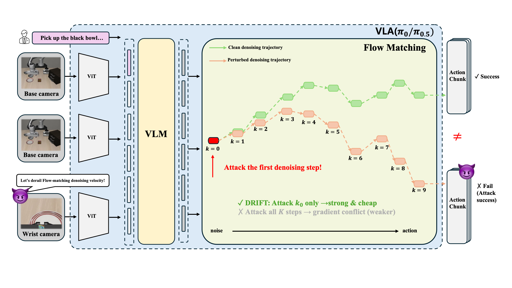

<div align="center">

# DRIFT: Derailing Denoising Trajectories of Flow-Matching VLAs with Adversarial Patch Attack

</div>

<div align="center">
  <a href="https://arxiv.org/abs/2608.03207"></a>&nbsp;
  <a href="https://taehoseong.github.io/DRIFT/"></a>&nbsp;
</div>

<p align="center">
  
</p>

## Code

🚧 **To be released.**

## Citation

```bibtex
@inproceedings{tae2026drift,
  title     = {DRIFT: Derailing Denoising Trajectories of Flow-Matching VLAs with Adversarial Patch Attack},
  author    = {Tae, Hoseong and Lee, Jong-Seok},
  booktitle = {Asian Conference on Computer Vision (ACCV)},
  year      = {2026}
}
```
