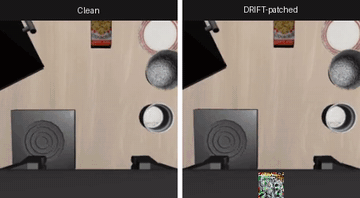
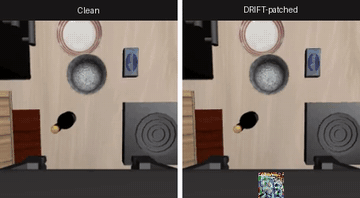
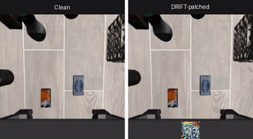
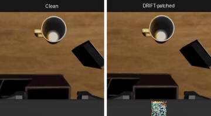

<div align="center">

# DRIFT: Derailing Denoising Trajectories of Flow-Matching VLAs with Adversarial Patch Attack

</div>

<div align="center">
  <a href="https://arxiv.org/abs/2608.03207"></a>&nbsp;
  <a href="https://taehoseong.github.io/DRIFT/"></a>&nbsp;
</div>

<p align="center">
  
</p>

## Overview

DRIFT is a **test-time universal adversarial patch** that attacks flow-matching
Vision-Language-Action models (π0 / π0.5) by maximizing the divergence between the
patched and clean **denoising velocity fields**. Counterintuitively, attacking only
the **first** denoising step is both stronger and cheaper than attacking a wider
window of steps. On π0 and π0.5 across four LIBERO suites, DRIFT breaks essentially
all originally-solvable tasks with a single small patch.

This repository contains the code to **train a DRIFT patch** and **evaluate it on
LIBERO**. The victim model (openpi) and the simulator (LIBERO) are external
dependencies — see [`REPRODUCE.md`](REPRODUCE.md) for full setup.

## Demo

π0 rollouts — **clean (left)** vs **DRIFT-patched (right)**. A single 32px wrist
patch derails the denoising trajectory and breaks the task across all four LIBERO suites:

| LIBERO-Spatial | LIBERO-Goal |
|:--------------:|:-----------:|
|  |  |
| **LIBERO-Object** | **LIBERO-Long** |
|  |  |

## Installation
This repositorry is built on top of [openpi](https://github.com/Physical-Intelligence/openpi) and [LIBERO](https://github.com/Lifelong-Robot-Learning/LIBERO). 

Please follow the upstream repo's README and prepare the enviorments.
```bash
# 1) openpi (π0/π0.5, JAX) — clone & set up per its README:
export OPENPI_ROOT=/path/to/openpi
export PI0_CHECKPOINT=/path/to/pi0_libero   # (pi05_libero for π0.5)

# 2) this repo
pip install -r requirements.txt
```

## Quickstart

```bash
./scripts/serve.sh                                   # A: start the policy server
./scripts/collect_obs.sh collected_obs_libero.npy    # B: collect a training obs pool
./scripts/attack.sh collected_obs_libero.npy patches/drift_patch.npy   # train the patch
./scripts/eval.sh patches/drift_patch.npy libero_spatial drift_spatial # evaluate → ASR
```

Pre-trained patches are in [`patches/`](patches) (`drift_pi0_32px.npy`,
`drift_pi05_64px.npy`) — evaluate directly without training. See
[`REPRODUCE.md`](REPRODUCE.md) for the π0.5 config and the "less-is-more"
(`--top-k-steps`) ablation.

## Repository structure

```
DRIFT/
├── attack_patch.py         # train the DRIFT patch (velocity-field divergence)
├── patch_eval_libero.py    # evaluate a patch on LIBERO (wrist bottom-center overlay)
├── collect_libero_obs.py   # build the training observation pool
├── utils/                  # patch application, velocity, LIBERO env helpers
├── scripts/                # serve / collect_obs / attack / eval
├── patches/                # released DRIFT patches (π0, π0.5)
├── docs/                   # project page
├── REPRODUCE.md            # full setup + command↔result mapping, less-is-more ablation
├── requirements.txt        # pip deps for this repo (openpi/LIBERO installed separately)
└── LICENSE                 # MIT
```

## Citation

```bibtex
@inproceedings{tae2026drift,
  title     = {{DRIFT}: Derailing Denoising Trajectories of Flow-Matching VLAs with Adversarial Patch Attack},
  author    = {Hoseong Tae and Jong-Seok Lee},
  booktitle = {Asian Conference on Computer Vision (ACCV)},
  year      = {2026}
}
```
